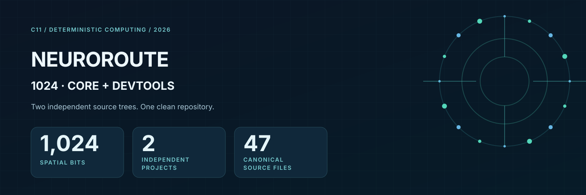
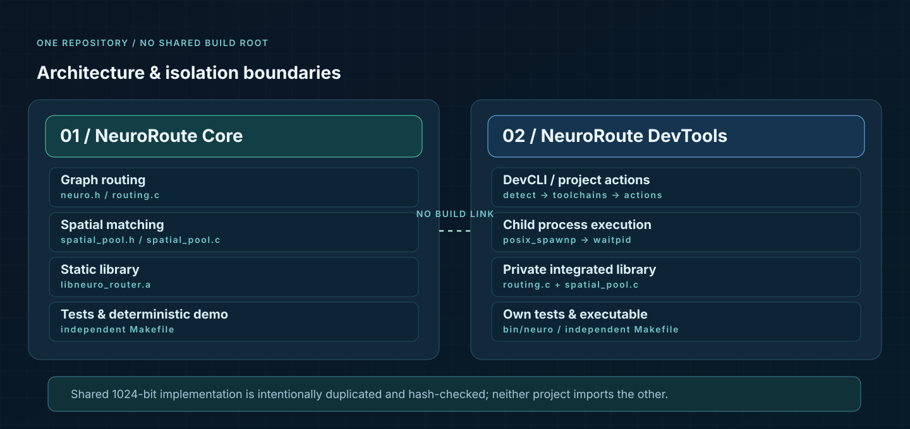
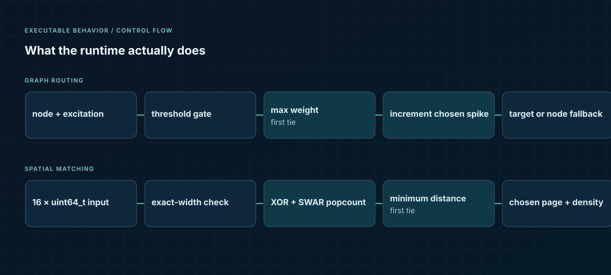
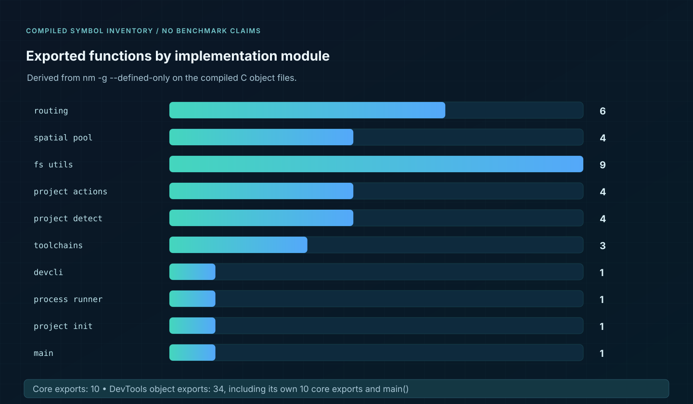

<div align="center">



**Deterministic C11 routing & exact-width 1024-bit spatial matching, plus independent DevTools.**

    

[Quickstart](docs/GETTING_STARTED.md) · [Source audit](audit/README.md) · [Runtime flow](assets/runtime-flow.svg) · [Validation](docs/TESTING.md) · [Project homepage](docs/index.html)

</div>

## Two products. One repository. No codebase mixing.

| Product | Role | Independent build | Entry points |
|---|---|---|---|
| **[NeuroRoute Core](projects/neuroroute-1024/README.md)** | 1,024-node graph router, 1,024-bit spatial Hamming match, static C library | `make -C projects/neuroroute-1024 test` | `lib/libneuro_router.a` |
| **[NeuroRoute DevTools](projects/neuroroute-devtools-1024/README.md)** | Project-language detection, toolchain resolution, project init/build/run/test/clean, editor, shell-free process launch | `make -C projects/neuroroute-devtools-1024 test` | `bin/neuro` |

There are **no Git submodules**, no nested `.git` directories, no cross-project compile/link dependencies, and no common object output directory. DevTools deliberately contains its **own byte-identical copy** of the core library implementation. This preserves its standalone build while making source drift auditable.



## Runtime mechanics



- **Graph router:** maximum configured edge weight, first-edge tie rule, excitation threshold, fallback to the node's base address, and spike counters.
- **Spatial pool:** exactly 16 64-bit lanes, full 1,024-bit XOR/Hamming-distance comparison, deterministic first-chunk tie rule, and increment of only the selected chunk's density.
- **Synchronization:** C11 atomic-flag locks protect the pool and routing topology; the edge spike increment uses a GCC/Clang atomic builtin.
- **DevTools:** detect project type, resolve installed external tools, and call those tools using argument-vector `posix_spawnp` (not `system()` or `sh -c`). It is **not** a sandbox or a compiler.



This graph shows **real exported functions in compiled object files**, not synthetic tests, speedup ratios, latency, or throughput numbers. See [the full symbol inventory](docs/FUNCTIONS.md).

## Get running

```sh
# Requires C11 compiler + make + ar; audit requires python3
python3 scripts/check_boundaries.py
make verify

# Launch the independently built developer CLI
./projects/neuroroute-devtools-1024/bin/neuro help
./projects/neuroroute-devtools-1024/bin/neuro status

# Build either project without touching the other
make -C projects/neuroroute-1024 test
make -C projects/neuroroute-devtools-1024 test
```

Expected deterministic demonstration:

```text
Selected route target: 1002
Selected spatial page: 8192
```

## Release evidence

- **47 canonical payload files** across the two independent projects (14 core, 33 DevTools), retained from the supplied archive. The duplicate `GIT/`, `NORMAL/`, `SOURCE/` source trees and four nested archives were compared byte-for-byte.
- **GCC + Clang** strict compilation, tests, and live demonstration passed locally on Linux; GCC `-fanalyzer` builds passed. Both compiler sanitizers passed with leak detection disabled; see limitations in [testing](docs/TESTING.md).
- **Four documented release edits**: one DevTools Makefile test-script portability fix, three README/architecture text clarifications. **No original C source or header files were rewritten.**
- No universal correctness proof, memory-safety certification, concurrency model-checking, whole-state-space enumeration, or unperformed cross-platform verification is claimed.
- [Local compiler, sanitizer and test logs](audit/LOCAL_VALIDATION.md) are included for independent review.

## Repo navigation

```text
NeuroRoute-1024-Monorepo/
├── projects/
│   ├── neuroroute-1024/           # core source + own Makefile/tests/license
│   └── neuroroute-devtools-1024/  # DevCLI + own core source + own tests
├── assets/                        # GitHub-compatible SVG architecture charts
├── docs/                          # function inventory, site, runbook, tests
├── audit/                         # hashes and duplicate-archive verification
├── scripts/                       # deterministic boundary verification
├── .github/workflows/ci.yml       # CI declaration (runs once pushed)
├── LICENSE                        # MIT, original project licenses retained
└── Makefile                       # optional root orchestration only
```

Project-specific licenses are retained in each tree; the root MIT license covers the repository's new supporting assets and documentation. The code will be pushed only when **you** choose to publish it.
